<a><picture><source media="(prefers-color-scheme: dark)" srcset="ring3/fog-0-0-dark.svg"></picture></a> 
<a><picture><source media="(prefers-color-scheme: dark)" srcset="ring3/fog-1-0-dark.svg"></picture></a><a href="https://aphes.ist/#book"><picture><source media="(prefers-color-scheme: dark)" srcset="ring3/book-dark.svg"></picture></a><a><picture><source media="(prefers-color-scheme: dark)" srcset="ring3/fog-1-2-dark.svg"></picture></a> 
<a><picture><source media="(prefers-color-scheme: dark)" srcset="ring3/fog-2-0-dark.svg"></picture></a><a href="https://github.com/aphesist/autopoiesis"><picture><source media="(prefers-color-scheme: dark)" srcset="ring3/autopoiesis-dark.svg"></picture></a><a><picture><source media="(prefers-color-scheme: dark)" srcset="ring3/fog-2-2-dark.svg"></picture></a><a href="https://anamnesis.aphes.ist/"><picture><source media="(prefers-color-scheme: dark)" srcset="ring3/anamnesis-dark.svg"></picture></a><a><picture><source media="(prefers-color-scheme: dark)" srcset="ring3/fog-2-4-dark.svg"></picture></a> 
<a><picture><source media="(prefers-color-scheme: dark)" srcset="ring3/fog-3-0-dark.svg"></picture></a><a href="https://aphes.ist/#forum"><picture><source media="(prefers-color-scheme: dark)" srcset="ring3/forum-dark.svg"></picture></a><a href="https://aphes.ist/"><picture><source media="(prefers-color-scheme: dark)" srcset="ring3/phi-dark.svg"></picture></a><a href="https://aphes.ist/#archive"><picture><source media="(prefers-color-scheme: dark)" srcset="ring3/archive-dark.svg"></picture></a><a><picture><source media="(prefers-color-scheme: dark)" srcset="ring3/fog-3-4-dark.svg"></picture></a> 
<a><picture><source media="(prefers-color-scheme: dark)" srcset="ring3/fog-4-0-dark.svg"></picture></a><a href="https://contraprova.aphes.ist/"><picture><source media="(prefers-color-scheme: dark)" srcset="ring3/contraprova-dark.svg"></picture></a><a><picture><source media="(prefers-color-scheme: dark)" srcset="ring3/fog-4-2-dark.svg"></picture></a><a href="https://github.com/aphesist/heuresis"><picture><source media="(prefers-color-scheme: dark)" srcset="ring3/heuresis-dark.svg"></picture></a><a><picture><source media="(prefers-color-scheme: dark)" srcset="ring3/fog-4-4-dark.svg"></picture></a> 
<a><picture><source media="(prefers-color-scheme: dark)" srcset="ring3/fog-5-0-dark.svg"></picture></a><a href="https://aphes.ist/#laboratory"><picture><source media="(prefers-color-scheme: dark)" srcset="ring3/laboratory-dark.svg"></picture></a><a><picture><source media="(prefers-color-scheme: dark)" srcset="ring3/fog-5-2-dark.svg"></picture></a> 
<a><picture><source media="(prefers-color-scheme: dark)" srcset="ring3/fog-6-0-dark.svg"></picture></a>

